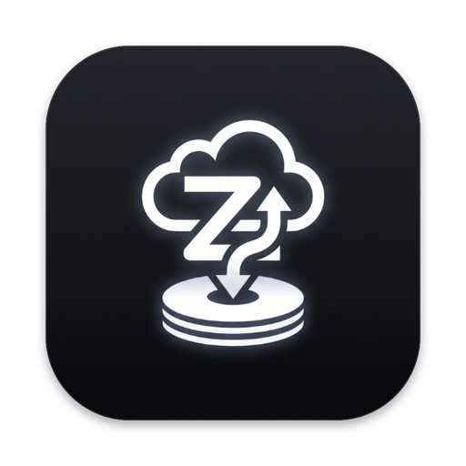

<div align="center">
  
  <h1>ZyDisk</h1>
  <p><b>Mount SFTP, FTP/FTPS and S3 storage as native drives in macOS Finder.</b></p>
  <p>A <a href="https://conaksoft.com">Conaksoft</a> product</p>
</div>

---

## Overview

**ZyDisk** is a native macOS app by [Conaksoft](https://conaksoft.com) that turns your remote servers and object storage into ordinary drives in Finder. Open, edit and save files on an SFTP server or an S3 bucket as if they were on your Mac. You can work with them in Finder, VS Code, Terminal or any other app.

ZyDisk uses the proven [rclone](https://rclone.org) engine and macOS's built-in **NFS client**. You don't need macFUSE, kernel extensions or lowered security settings on Apple Silicon.

**Who is it for?** Web developers editing sites directly on a server, teams sharing files over FTP, and anyone who works with S3-compatible storage (AWS S3, Cloudflare R2, MinIO, Wasabi, Backblaze B2 and others).

## Key Features

- **Native Finder drives:** Each connection appears under `/Volumes` like a USB disk. No kernel extension or macFUSE install.
- **SFTP/SSH, FTP, FTPS and S3-compatible storage:** Password or SSH key authentication.
- **No repeated password prompts:** A small background helper is installed once with your approval. After that, connecting and ejecting never ask for your Mac password.
- **Touch ID:** Revealing a saved password or resetting the app is confirmed with Touch ID, or your Mac password on Macs without Touch ID.
- **No `._` clutter on your server:** macOS writes hidden AppleDouble (`._file`) and `.DS_Store` files to network drives. ZyDisk removes them from the server as they are uploaded (can be turned off in Settings), and can sweep existing ones on request.
- **Uninterrupted mounts:** If the engine stops unexpectedly, it restarts within seconds and Finder keeps working. Drives stay mounted across app restarts, and pending uploads finish before a drive is fully released.
- **Credentials stay secure:** Passwords are kept in the macOS Keychain, never written to configuration files in plain text and never visible in the process list.
- **Find drives quickly:** Search, filter by status or protocol, sort, and group by protocol, status or server.
- **Live status:** Upload queue and transfer speed per drive, auto-connect on launch, launch at login, connect and eject from the menu bar.
- **Developer shortcuts:** Open any drive in **Finder**, **VS Code** or **Terminal** with one click.

## Requirements

- macOS 13 Ventura or later (Apple Silicon or Intel)
- An administrator account for the one-time background helper installation
- Internet access on first launch: ZyDisk downloads the official rclone binary from rclone.org

## Installation

ZyDisk is distributed as source code. Build it on your Mac as described below.

## Building from Source

You need **Flutter** (3.41 or later) and **Xcode**.

```bash
git clone https://github.com/conaksoft/zydisk.git
cd zydisk
flutter pub get
flutter build macos
```

The app is written in Flutter (UI) and Swift (privileged XPC helper, Keychain, Touch ID and system integration).

## Security & Privacy

- All connection details are stored **only on your Mac**. Passwords are kept in the macOS Keychain.
- ZyDisk does **not** collect telemetry, analytics, usage data or credentials, and does not send your data to Conaksoft.
- Your files move directly between your Mac and the servers you configure.
- The background helper accepts requests only from the ZyDisk app. It can only mount and unmount ZyDisk's own local NFS drives under `/Volumes`.

## Disclaimer

> **Please read carefully before using ZyDisk.**

1. **Provided "as is".** ZyDisk is provided "AS IS" and "AS AVAILABLE", without warranty of any kind, express or implied. This includes, without limitation, warranties of merchantability, fitness for a particular purpose, accuracy and non-infringement.
2. **Limitation of liability.** To the maximum extent permitted by applicable law, Conaksoft and its contributors are not liable for any direct, indirect, incidental, special, consequential or exemplary damages. This includes loss or corruption of data, loss of profits, service interruption, security incidents, or costs of substitute goods or services, arising from the use of or inability to use ZyDisk, even if advised of the possibility of such damages.
3. **Your data is your responsibility.** Network drives depend on network conditions, remote servers and local caching. Files written to a ZyDisk drive are uploaded to the server in the background and may be delayed, may fail, or may conflict with changes made elsewhere. **Always keep independent backups** of important data, and do not use ZyDisk as your only copy of any file.
4. **Automatic deletion of system files.** When the **Settings → Dosyalar → "._ ve .DS_Store dosyalarını sunucuya bırakma"** option is enabled (the default), ZyDisk deletes files named `._*`, `.DS_Store` and `.apdisk` that macOS uploads through ZyDisk. The "clean server" action deletes every file matching these names under the selected remote path. If you rely on such files, disable the feature and do not use the clean action.
5. **Privileged component.** ZyDisk installs a background helper that runs with administrator (root) privileges, so that it can mount drives. You install it at your own discretion and can remove it at any time from Settings.
6. **Third-party services and costs.** You are solely responsible for your use of the servers and storage providers you connect to. This includes complying with their terms of service, obtaining the necessary authorization to access them, and any fees they charge (for example S3 request, storage or data-transfer charges).
7. **No professional advice.** ZyDisk is a general-purpose tool. You are responsible for judging whether it is suitable for your use case, including any regulated, critical or production environment.
8. **Trademarks.** Apple, macOS, Finder, Touch ID, Amazon S3, Visual Studio Code and other names are trademarks of their respective owners. ZyDisk is not affiliated with, endorsed by or sponsored by Apple Inc., Amazon.com Inc., Microsoft Corporation or the rclone project.

By installing or using ZyDisk you agree to these terms.

## License

ZyDisk is **source available** under the [PolyForm Noncommercial License 1.0.0](LICENSE).

- **Free** for personal use, study, research, hobby projects and non-profit organizations.
- **Commercial use requires a license.** This includes using ZyDisk at work or inside a company, selling it, or building a product or service on it. Write to [contact@conaksoft.com](mailto:contact@conaksoft.com) for a commercial license.
- The ZyDisk name and logo are not covered by the license and may not be used for other products.

## Third-Party Software

ZyDisk downloads and runs [rclone](https://github.com/rclone/rclone) (MIT License). It is built with [Flutter](https://flutter.dev) (BSD 3-Clause License) and open-source Dart packages, each under its own license. Their copyright notices belong to their respective authors.

## Türkçe Özet

**ZyDisk**, [Conaksoft](https://conaksoft.com) tarafından geliştirilen bir macOS uygulamasıdır. SFTP/SSH, FTP/FTPS ve S3 uyumlu depolamaları Finder'da yerel bir disk gibi bağlar; macFUSE veya çekirdek uzantısı gerektirmez. Bir kez kurulan arka plan servisi sayesinde bağlanırken ve ayırırken parola sormaz. Parolalar macOS Anahtar Zinciri'nde saklanır; uygulama hiçbir kullanım verisi toplamaz.

**Sorumluluk reddi:** ZyDisk "olduğu gibi" sunulur ve hiçbir garanti verilmez. Yürürlükteki mevzuatın izin verdiği en geniş ölçüde Conaksoft, uygulamanın kullanımından veya kullanılamamasından doğan veri kaybı, veri bozulması, hizmet kesintisi, güvenlik olayları ve kâr kaybı dahil hiçbir doğrudan veya dolaylı zarardan sorumlu değildir. Önemli verilerinizin her zaman bağımsız yedeğini alın. Varsayılan olarak açık olan temizlik özelliği, macOS'un sunucuya yüklediği `._*`, `.DS_Store` ve `.apdisk` dosyalarını siler. Bağlandığınız sunucuların kullanım koşullarına uymak, erişim yetkisine sahip olmak ve servis sağlayıcıların ücretleri sizin sorumluluğunuzdadır. Uygulama, kişisel verileri Conaksoft'a göndermez; tüm bilgiler yalnızca kendi bilgisayarınızda işlenir. Uygulamayı kurarak veya kullanarak bu koşulları kabul etmiş sayılırsınız.

**Lisans:** ZyDisk'in kaynak kodu [PolyForm Noncommercial 1.0.0](LICENSE) lisansıyla açıktır. Kişisel, eğitim, araştırma ve kâr amacı gütmeyen kullanım ücretsizdir. İş yerinde kullanım, satış veya ticari bir ürüne dahil etme gibi ticari kullanımlar için [contact@conaksoft.com](mailto:contact@conaksoft.com) adresinden lisans alınması gerekir.

---
<div align="center">
  <p>ZyDisk is a product of <a href="https://conaksoft.com">Conaksoft</a>.<br>Copyright © 2026 Conak Soft LLC · <a href="LICENSE">PolyForm Noncommercial 1.0.0</a></p>
</div>
